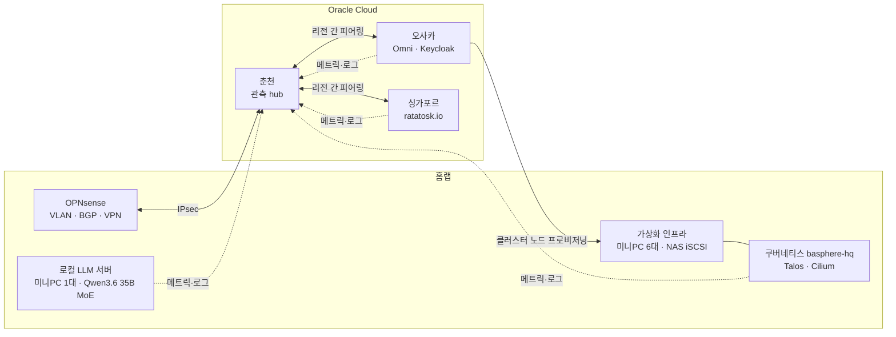

# basphere

혼자 설계하고 운영하는 하이브리드 인프라입니다. 집에 있는 미니PC 7대와 NAS, OPNsense 방화벽을 Oracle Cloud 3개 리전과 VPN으로 묶어서 관측 스택, 쿠버네티스 클러스터, 로컬 LLM 서버, 실서비스를 돌립니다. 미니PC 6대는 가상화 인프라를 이루고, 1대는 LLM 서버입니다. 2026년 3월에 관측 스택부터 시작했습니다.

이 레포는 소개 문서입니다. 실제 설정을 담은 레포(관측 스택, Omni와 클러스터, IaC)는 IP와 자격 정보 때문에 비공개로 둡니다.

## 구성

| 영역 | 구성 |
|---|---|
| 컴퓨트 | 미니PC 7대. 가상화 호스트 6대(Ryzen 7 5800H, 64GB, 합계 48코어·96스레드·384GB)는 HA 클러스터로 묶었고, LLM 서버 1대(Ryzen 7 8845HS, 64GB)는 따로 둔다 |
| 스토리지 | Synology NAS. SSD RAID5 약 7TiB를 iSCSI로 가상화 스토리지에 연결(다중 경로), HDD RAID1 약 3.5TiB |
| 네트워크 | OPNsense(VLAN 분리, 쿠버네티스와 eBGP, IPsec·WireGuard), 1GbE 스위치. VM 구간 MTU 1450, 스토리지 구간 MTU 9000 |
| 쿠버네티스 | Talos 1.13, Kubernetes 1.36, 컨트롤 플레인 3 + 워커 3. 노드는 Sidero Omni가 가상화 인프라 위에 자동으로 만든다 |
| 로컬 LLM | 위 LLM 서버. Radeon 780M 내장 GPU가 64GB 통합 메모리를 나눠 쓴다. Ollama(Vulkan) |
| 클라우드 | OCI 테넌시 4개(춘천·오사카·싱가포르), ARM 인스턴스. OpenTofu로 관리 |

홈랩 장비와 성능 기준선은 [홈랩 인프라](docs/infrastructure.md), 클라우드 연결과 IaC는 [하이브리드 클라우드](docs/hybrid-cloud.md)에 자세히 정리했습니다.

## 운영하는 것

### 관측 스택

VictoriaMetrics, Loki, Grafana, vmalert, Alertmanager, Grafana Alloy를 춘천 인스턴스 한 대에서 docker compose로 돌립니다. 홈랩과 클라우드의 원격 사이트 6곳이 각자의 Alloy로 메트릭과 로그를 보내고, 받는 쪽은 사이트별 토큰으로 인증하는 관문(vmauth) 하나입니다. 활성 시계열은 약 14만 개입니다.

- 알람은 판정 규칙을 정해 두고 씁니다. 상태 값(레벨)과 증가율을 구분하고, 대상이 죽으면 함께 사라지는 메트릭은 따로 처리하고, 서버가 직접 내놓는 값으로 판정합니다.
- 알람 경로 자체가 죽는 경우는 외부 heartbeat 서비스(Healthchecks.io)가 잡습니다.
- 대시보드 쿼리와 알람 룰은 배포 전에 실제 데이터로 검증합니다. 변수 드롭다운 조합은 Playwright로 렌더해 비어 있는 패널을 찾습니다.

자세히: [관측 스택](docs/observability.md)

### 쿠버네티스 basphere-hq

- 클러스터 수명주기는 오사카의 Sidero Omni가 관리합니다. 노드가 필요하면 Omni의 프로비저너가 홈랩 가상화 인프라에 VM을 만들고 Talos를 설치합니다. 이 프로비저너에는 필요한 기능을 직접 기여했습니다(아래 기여 목록).
- Cilium이 kube-proxy를 대체합니다. native routing, DSR과 XDP를 쓰고, LoadBalancer IP는 OPNsense와 BGP로 광고합니다. 외부 노출은 Gateway API입니다.
- 영구 볼륨은 CSI 드라이버가 NAS의 iSCSI 스토리지에 만듭니다.
- 쿠버네티스 AI 에이전트 프레임워크 kagent와 MCP 서버를 운영하면서 클라우드 모델(Gemini)과 로컬 모델(Qwen)을 비교 평가했습니다.

자세히: [쿠버네티스](docs/kubernetes.md)

### 로컬 LLM

외장 GPU가 없는 미니PC에서 35B MoE 모델(Qwen3.6-35B-A3B, 컨텍스트 262k)을 서빙합니다. 시스템 메모리를 GPU 메모리로 빌려 쓰는 통합 메모리 구조라서 가능한 구성이고, 생성 속도는 메모리 대역폭이 정합니다. 측정과 튜닝 과정은 블로그 연재 1~4부에 있고, 요약은 [로컬 LLM](docs/local-llm.md)에 있습니다.

### ratatosk.io

CNCF 프로젝트 70여 개의 릴리스를 분석해 호환성 변경, CVE, 업그레이드 주의점을 사람과 AI 에이전트에게 제공하는 서비스입니다. 기획부터 개발, 운영까지 혼자 합니다. 에이전트용 MCP 서버는 [ratatosk-mcp](https://github.com/garlicKim21/ratatosk-mcp)로 공개했습니다.

자세히: [ratatosk.io](docs/ratatosk.md)

## 설계 판단

결정마다 기각한 대안과 근거를 기록으로 남깁니다. 몇 가지만 옮기고, 전체는 [설계 판단](docs/decisions.md)에 있습니다.

| 결정 | 근거 |
|---|---|
| 관측 hub는 쿠버네티스가 아니라 docker compose로 둔다 | 관측 호스트는 다른 것이 다 망가져도 살아서 보여 줘야 합니다. 쿠버네티스로 옮기면 API 서버가 죽을 때 관측까지 같이 어두워집니다. 쿠버네티스 경험은 hq 클러스터가 맡습니다 |
| VictoriaMetrics를 Mimir로 바꾸지 않는다 | 2026-08 실측 0.42 byte/sample, 메모리 1.1GB. Mimir의 수평 확장과 객체 스토리지 전제는 이 규모에서 비용만 늘리고, 인증 관문(vmauth)과 룰 엔진(vmalert)을 잃습니다 |
| 원격 사이트는 hub로 보내고(push), 받는 문은 하나로 | 원격 사이트는 나가는 방향 한 줄만 열면 됩니다. 사이트마다 토큰을 따로 발급해 유출 시 추적과 회수가 됩니다 |
| 배포는 서버가 git을 당겨 적용한다(설계 완료, 적용 준비 중) | CI가 SSH로 밀어 넣는 방식, self-hosted 러너, 중앙 배포 도구(Komodo), 웹훅을 비교했습니다. 서버에 들어오는 연결이 없고 서버에는 읽기 전용 키만 두는 pull 방식을 골랐습니다. 승인은 PR 머지가 맡습니다 |

## 사고와 측정

사고 여섯 건의 전체 기록은 [사고 기록](docs/incidents.md)에 있습니다.

| 주제 | 내용 |
|---|---|
| docker 서브넷이 VPN 경로를 가로챈 사고(2026-09) | 서브넷을 지정하지 않은 docker 네트워크가 /16 대역을 자동으로 받았고, 그 경로가 VPN 너머 클러스터 대역보다 구체적이어서 응답 패킷이 엉뚱한 브리지로 나갔습니다. 클러스터 메트릭 전송이 약 7시간 끊겼습니다. 알람은 15분 만에 울렸지만 사람이 보지 못했습니다. 재발 방지로 새 네트워크의 서브넷 명시와 경로 확인을 규칙으로 만들었습니다. 전송 단절만 따로 잡는 알람은 후속 과제로 남아 있습니다 |
| 스크레이핑 봇넷(2026-08) | 14시간 동안 요청 197만 건(평시 50배), 주거용 프록시 IP 2만 6천여 개. Cloudflare Managed Challenge를 적용하고 6분 만에 97%를 막았습니다. 웹 서비스 담당과 관측 담당 AI 에이전트가 문서로 진단을 나눠 맡았습니다([보고서](https://tech-recipe.tistory.com/54)) |
| iSCSI 다중 경로 튜닝(2025-12) | 1GbE 단일 링크에서 Round Robin 경로 전환 단위를 1 IOPS로 바꿔 IOPS를 57% 올렸습니다(17,559에서 27,543). 대신 P99 지연이 나빠지는 트레이드오프를 확인했습니다([글](https://tech-recipe.tistory.com/53)) |
| 네트워크·스토리지 기준선(2026-07) | 호스트를 넘는 VM 트래픽의 천장은 USB NIC 실효 약 500Mb/s, 스토리지 랜덤 IO의 천장은 NAS CPU 포화(약 48k IOPS)로 특정했습니다 |
| 로컬 LLM 튜닝(2026-09) | 입력 처리 351 tok/s(입력 4.8k)에서 85 tok/s(입력 118k)로 떨어지는 구조를 측정했습니다. 생성은 메모리 대역폭이 병목이고, 다중 토큰 예측(MTP)으로 22~39% 올렸습니다. IOMMU 끄기, GPU 워치독 10초, 배치 512로 정리했습니다([글](https://tech-recipe.tistory.com/58)) |
| 프롬프트 캐시가 전혀 맞지 않던 문제(2026-09) | kagent의 Go 런타임에서 모델 호출 19번이 모두 캐시를 쓰지 못했습니다. 원인은 Go 맵의 순회 순서였습니다. 툴 정의와 툴 호출 인자의 순서가 요청마다 바뀌어 프롬프트 앞부분이 매번 달라졌습니다. 수정 2건이 머지됐고 다시 읽는 양이 새로 붙은 양의 1.0배가 됐습니다([글](https://tech-recipe.tistory.com/59)) |

## upstream 기여

운영하다 부딪힌 문제를 upstream에서 고쳤습니다. 모두 머지됐습니다.

| 프로젝트 | PR | 출발점 |
|---|---|---|
| kagent | [#2693](https://github.com/kagent-dev/kagent/pull/2693), [#2988](https://github.com/kagent-dev/kagent/pull/2988) | 로컬 LLM의 프롬프트 캐시 미적중 |
| kagent | [#2351](https://github.com/kagent-dev/kagent/pull/2351), [#2352](https://github.com/kagent-dev/kagent/pull/2352), [#2355](https://github.com/kagent-dev/kagent/pull/2355) | UI를 쓰다 만난 줄바꿈, 테마, 모델 서명 노출 |
| omni-infra-provider-vsphere | [#32](https://github.com/siderolabs/omni-infra-provider-vsphere/pull/32) | Omni를 ARM 인스턴스에서 돌리기 위한 arm64 이미지 |
| omni-infra-provider-vsphere | [#37](https://github.com/siderolabs/omni-infra-provider-vsphere/pull/37), [#42](https://github.com/siderolabs/omni-infra-provider-vsphere/pull/42) | 노드 디스크마다 스토리지 정책 적용, 이미지 배포 방식 개선 |
| omni-infra-provider-vsphere | [#44](https://github.com/siderolabs/omni-infra-provider-vsphere/pull/44) | 배포 실패 뒤 재시도할 때 VM이 새던 문제 |
| opnsense-exporter | [#105](https://github.com/AthennaMind/opnsense-exporter/pull/105) | 실제 API와 달라 DHCP 임대 응답을 해석하지 못하던 문제 |

## AI 에이전트와 운영하는 방식

호스트마다 담당 AI 에이전트(Claude Code)가 있고, 에이전트끼리는 문서를 주고받으며 일합니다. 변경은 레포 커밋으로만 들어갑니다. 커밋 전 시크릿 스캔, 배포 전 검증, 범위를 벗어난 변경은 사람에게 확인받기 같은 규칙을 코드와 문서로 고정해 두었습니다. 지금은 에이전트 실행 환경을 NanoClaw로 옮기고 있습니다.

## 글

- 로컬 LLM 구축기: [1부 외장 GPU 없이도 된다고요?](https://tech-recipe.tistory.com/55) · [2부 요청 하나가 답변이 되기까지](https://tech-recipe.tistory.com/57) · [3부 극한의 튜닝으로 토큰 쥐어짜기](https://tech-recipe.tistory.com/58) · [4부 캐시는 왜 하나도 맞지 않았나?](https://tech-recipe.tistory.com/59)
- [AI 에이전트를 활용한 봇넷 공격 방어 조치 보고서](https://tech-recipe.tistory.com/54)
- [iSCSI 성능 튜닝 심층 분석: 1Gbps 극한 사용과 Latency의 상관관계](https://tech-recipe.tistory.com/53)
- [리눅스 커널로 본 Containerd: 프로세스 트리와 Cgroup](https://tech-recipe.tistory.com/52)
- [OCI와 OPNsense로 하이브리드 클라우드 네트워크 연동하기](https://tech-recipe.tistory.com/49)
- 좀비 프로세스 [1편](https://tech-recipe.tistory.com/17) · [2편](https://tech-recipe.tistory.com/18) · [3편](https://tech-recipe.tistory.com/19), 재현 코드 [zombie-process-demo](https://github.com/garlicKim21/zombie-process-demo)

영상은 [YouTube @Basphere](https://www.youtube.com/@Basphere)에 올립니다.
