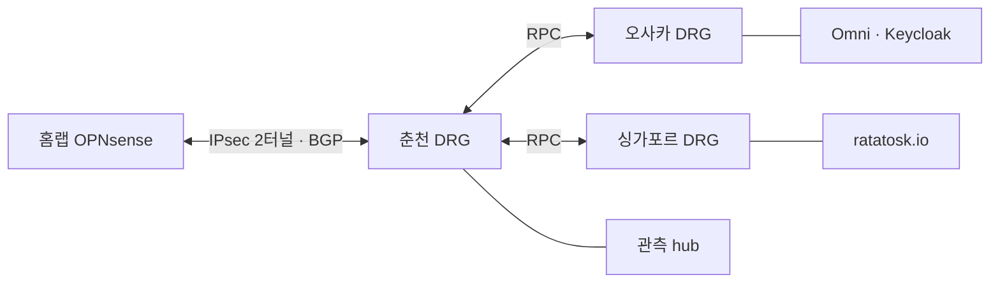

# 하이브리드 클라우드

홈랩과 Oracle Cloud(OCI)를 어떻게 묶었는지 정리합니다. 홈랩 쪽 장비는 [홈랩 인프라](infrastructure.md), 전체 그림은 [README](../README.md)에 있습니다.

## 테넌시와 리전

OCI 계정(테넌시) 4개를 3개 리전에 나눠 씁니다. 인스턴스는 전부 ARM(A1)입니다.

| 테넌시 | 리전 | 들어 있는 것 |
|---|---|---|
| 춘천 | ap-chuncheon-1 | 관측 hub 인스턴스(4 OCPU, 24GB), 네트워크 허브(DRG), 홈랩과의 IPsec, IaC 상태 버킷 |
| 오사카 1 | ap-osaka-1 | Sidero Omni, Keycloak(각 2 OCPU, 12GB) |
| 오사카 2 | ap-osaka-1 | 비어 있음. 다음 서비스용 예비 |
| 싱가포르 | ap-singapore-1 | ratatosk.io(4 OCPU, 24GB, 데이터 볼륨 별도) |

관측 hub가 무엇을 하는지는 [관측 스택](observability.md), Omni는 [쿠버네티스](kubernetes.md), ratatosk.io는 [ratatosk.io](ratatosk.md)에 있습니다.

## 연결 구조

춘천을 허브로 두는 hub-spoke 구조입니다. 홈랩은 춘천과만 IPsec을 맺고, 오사카와 싱가포르는 춘천 DRG와 리전 간 피어링(RPC)으로 연결됩니다. 그래서 홈랩에서 오사카나 싱가포르로 가는 사설 트래픽은 춘천을 거칩니다.

### 홈랩과 춘천: IPsec

- 터널은 2개이고 IKEv2, 경로 기반(VTI)입니다. 한쪽 터널이 끊기면 다른 쪽으로 넘어갑니다.
- 터널 위에서 BGP를 돌립니다. OPNsense는 FRR 플러그인으로 OCI DRG와 피어링하고, 광고할 대역은 prefix list로 제한합니다. 정적 경로를 손으로 맞출 필요가 없습니다.
- 쿠버네티스 LoadBalancer 대역은 클라우드 쪽으로 광고하지 않습니다. 홈랩 안에서만 쓰는 대역입니다.
- 30일 동안 홈랩에서 OCI로 약 190GB가 나갔습니다. 대부분 관측 데이터(메트릭과 로그)이고, 5분 평균 최고치는 3.7Mb/s입니다(2026-10-05 측정).

구성 과정은 [블로그 글](https://tech-recipe.tistory.com/49)에 있습니다.

### 리전 사이: 테넌시를 넘는 RPC

리전마다 테넌시가 달라서, 같은 테넌시 안의 피어링보다 한 단계가 더 있습니다. 양쪽 테넌시에 서로를 허락하는 IAM 정책(ENDORSE, ADMIT, DEFINE)을 두고 나서야 RPC가 연결됩니다. 춘천과 오사카 사이의 RPC는 양 끝이 모두 IaC 안에 있습니다.

## 지연 (2026-10-05)

| 구간 | 왕복 시간 |
|---|---|
| 홈랩 ↔ 춘천(IPsec) | 3.3~3.7ms |
| 춘천 ↔ 오사카(사설 경로) | 33.5ms |
| 춘천 ↔ 싱가포르(사설 경로) | 100ms |
| 홈랩 ↔ 오사카, 싱가포르 | 약 37ms, 약 103ms(춘천 경유 합산 추정) |

홈랩과 춘천이 3ms대로 붙어 있어서, 관측 hub가 홈랩 장비를 클라우드에서 직접 긁어 오는 수집도 무리 없이 돕니다.

## DNS

관측 hub는 OCI VCN 리졸버 하나만 씁니다. 리졸버에 전달 규칙을 하나 두어, 홈랩 내부 존의 이름만 IPsec 너머 OPNsense의 DNS 서버로 넘기고, 나머지 이름은 인터넷으로 풉니다. 리졸버가 우리 경로(DRG, IPsec)를 타고 나가도록 전달용 엔드포인트를 hub와 같은 서브넷에 두었습니다.

2026-09-25 전까지는 hub의 모든 DNS 조회가 VPN 너머 OPNsense로 갔습니다. VPN이 흔들리면 인터넷 이름 풀이까지 같이 흔들리는 구조라, 내부 이름만 VPN을 타도록 바꿨습니다.

내부 존 이름이 `.local`로 끝나는 데서 오는 함정도 하나 있었습니다. `.local`은 표준상 멀티캐스트 DNS(mDNS) 몫이라, 리졸버 클라이언트에 이 존을 일반 DNS로 물으라고 명시하지 않으면 조회가 어디로도 가지 않고 실패합니다.

## IaC

OCI 자원은 OpenTofu로 관리합니다.

- 레포 하나에서 테넌시 4개를 다룹니다. 테넌시마다 API 자격을 따로 두고 provider를 별칭으로 나눴습니다.
- 상태 파일은 춘천의 버킷 하나에 테넌시별 키로 나눠 둡니다(S3 호환 백엔드).
- 변경은 PR로 올리고, plan 결과를 보고 승인한 뒤 apply합니다. 실행은 GitHub 호스티드 러너가 하고, 자격은 테넌시별 GitHub Environment로 범위를 나눴습니다. 정기 plan으로 콘솔에서 생긴 차이(드리프트)도 잡습니다.
- 이미 콘솔로 만들어 둔 자원은 코드로 옮긴 뒤 plan이 "변경 없음"이 될 때까지 맞추는 방식으로 편입했습니다.

일부러 IaC 밖에 둔 것이 두 가지 있습니다.

| 자원 | 이유 |
|---|---|
| IPsec 연결 | 반쪽이 OPNsense에 있어서, 클라우드 쪽만 다시 만들면 스스로 복구되지 않습니다 |
| 관측 hub 인스턴스 | 쌓인 시계열과 로그는 다시 만들 수 없습니다. IaC가 실수로 지우거나 다시 만드는 일이 없게 밖에 뒀습니다 |

이 방식이 제 역할을 한 첫 사례가 있습니다. 기존 보안 규칙을 코드로 옮길 때 조회 스크립트가 필드 두 개를 빠뜨린 채 코드를 만들었고, 첫 plan이 11건의 변경을 띄웠습니다. apply하지 않고 멈춰 원인을 찾았고, 코드를 고쳐 "변경 없음"으로 맞춘 뒤에 넘어갔습니다. plan 결과가 조회 스크립트보다 실물에 대한 더 정확한 답이라는 것, 그리고 "변경 없음 전에는 apply하지 않는다"는 규칙은 도구가 아니라 사람이 지킬 때 작동한다는 것을 배웠습니다.
