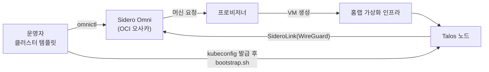

# 쿠버네티스 basphere-hq

[README](../README.md)로 돌아가기

홈랩의 주력 쿠버네티스 클러스터입니다. 노드는 홈랩 가상화 인프라 위의 VM 6대이고, 클러스터 수명주기는 Oracle Cloud 오사카 리전의 Sidero Omni가 관리합니다. 클러스터 안 구성은 레포의 부트스트랩 스크립트로 적용합니다. 이 문서의 수치는 2026-10-06 기준입니다.

## 수명주기와 노드 프로비저닝

1. 클러스터 모양은 Omni의 클러스터 템플릿(프로필)으로 정합니다. 적용 전에 바뀔 내용을 diff로 먼저 봅니다.
2. Omni가 머신 요청을 만들면 프로비저너가 가상화 인프라에 VM을 만들고 Talos 이미지로 부팅합니다. 노드는 SideroLink(WireGuard)로 Omni에 붙습니다.
3. Omni가 Talos 설정을 내려 클러스터를 구성합니다. kubeconfig는 Omni에서 서비스 계정 방식으로 발급받아 브라우저 로그인 없이 씁니다.
4. 클러스터 안 구성 요소는 `bootstrap.sh`가 순서대로 적용합니다. Gateway API CRD, Cilium, 클라우드 프로바이더(CPI), CSI 드라이버, 스냅샷 컨트롤러, metrics-server, BGP 설정, 모니터링 순서입니다. 멱등이라 끊긴 단계부터 이어서 돌릴 수 있습니다.

프로비저너는 이 구성을 운영하면서 필요한 기능(스토리지 정책 적용, 이미지 배포 방식, 실패 뒤 재시도 때 VM 누수 수정)을 upstream에 직접 기여했습니다. 목록은 [README의 upstream 기여](../README.md#upstream-기여)에 있습니다.

## 머신 클래스와 프로필

| 구분 | 내용 |
|---|---|
| 머신 클래스 | 컨트롤 플레인용 3종(extra-small, small, medium), 워커용 3종(small, medium, large). 가장 큰 워커는 8 vCPU, 32GB, 디스크 150GB |
| 프로필 | dev는 비HA(노드 수로 키움), prod는 HA(노드 규격으로 키움). small과 medium 두 단계씩 |
| 현재 | prod/medium. 컨트롤 플레인 3대(2 vCPU, 8GB, 50GB), 워커 3대(4 vCPU, 16GB, 100GB) |
| 버전 | Kubernetes v1.36.2, Talos v1.13.6, containerd 2.2.5 |
| 여유 | 워커 할당 가능 11.85코어, 45.4GiB 중 requests 합계 1.15코어, 2.7GiB |

머신 클래스는 Omni 전체에서 쓰는 공용 틀이라 클러스터 설정과 계층을 나눠 둡니다. 두 번째 클러스터가 같은 틀을 쓰게 되면 별도 레포로 떼어 낼 계획입니다. 클러스터의 Talos 버전은 VM 이미지 버전과 맞춥니다. 프로필이 이미지보다 낮은 버전을 요구하면 다운그레이드가 되기 때문입니다.

## Cilium

| 항목 | 설정 |
|---|---|
| 서비스 처리 | kube-proxy를 끄고 Cilium이 대체합니다. API 서버는 Talos KubePrism으로 노드마다 로컬 HA처럼 접근합니다 |
| 데이터패스 | native routing과 netkit. 노드가 한 L2 구간에 있는 구성입니다 |
| 로드밸런싱 | TCP는 DSR, UDP는 SNAT(hybrid 모드), XDP 가속, maglev. 파드에는 BBR |
| LoadBalancer IP | Cilium LB-IPAM 풀 하나. `bgp-advertise` 라벨이 붙은 서비스만 BGP로 광고합니다 |
| BGP | 클러스터 AS 65100, OPNsense AS 65000의 eBGP. 워커만 피어링하고, graceful restart로 노드를 돌아가며 재시작하는 중에도 경로를 유지합니다 |
| 외부 진입 | Gateway API. 공용 Gateway 하나가 모든 네임스페이스의 HTTPRoute를 받습니다 |
| MTU | 1450 |

MTU를 1450으로 둔 이유는 가상화 호스트의 VM 트래픽용 USB NIC가 VLAN 태그 4바이트를 1500 프레임 안에서 처리하기 때문입니다. 이 값을 빠뜨렸을 때는 큰 패킷만 조용히 버려져 이미지 레지스트리와의 TLS 핸드셰이크가 타임아웃났습니다. Talos 설정 패치는 NIC 이름 대신 물리 장치 선택자로 걸어 노드 이름 규칙이 바뀌어도 깨지지 않게 했습니다.

DSR은 가상 스위치가 VM의 MAC 위조 전송을 허용해야 동작합니다. 가상 스위치 보안 설정을 바꾸면 DSR이 오류 없이 깨지므로 그 의존 관계를 문서로 남겨 두었습니다.

외부 노출 경로는 Cloudflare DNS, 홈랩 공인 IP, OPNsense nginx(TLS 종료), Gateway, HTTPRoute 순입니다. TLS를 OPNsense가 끝내서 클러스터 안에는 인증서가 없습니다. LoadBalancer IP는 홈랩 안에서만 닿고, 클라우드 쪽에서 닿게 하려면 VPN 정책을 따로 열어야 합니다.

## 스토리지

- 영구 볼륨은 가상화 인프라용 CSI 드라이버가 NAS의 iSCSI 스토리지에 블록 볼륨으로 만듭니다. StorageClass는 하나이고 RWO, WaitForFirstConsumer, 확장 가능입니다. 스냅샷 컨트롤러로 볼륨 스냅샷을 씁니다.
- VM 디스크와 영구 볼륨은 서로 다른 스토리지 영역에 둡니다.
- 노드가 클라우드 프로바이더 미초기화 taint를 달고 뜨기 때문에 CPI가 노드 정보를 채우기 전에는 앱 파드가 스케줄되지 않습니다. Cilium은 그 taint를 견뎌서, CPI를 빠뜨리면 "CNI는 됐는데 파드가 Pending"으로 보입니다.
- 스토리지 정책으로 볼륨별 IOPS 상한을 걸어 봤지만, 정책이 붙은 상태에서도 볼륨 셋이 각각 약 9.4k IOPS를 냈습니다(2026-07 측정). 볼륨별 QoS가 필요하면 물리 계층을 나눠야 한다고 결론 냈습니다.
- 볼륨은 줄일 수 없고, 확장은 파드가 재시작될 때 끝납니다. 꽉 찬 뒤에 대응하면 정지 구간이 생기므로 사용률 알람을 미리 겁니다.

## 모니터링

클러스터 안에는 장기 저장도 대시보드도 두지 않습니다. Grafana Alloy가 수집해 관측 스택의 인입 관문으로 보내고, 조회와 알람은 관측 hub가 맡습니다([관측 스택](observability.md)).

- 메트릭: Alloy StatefulSet 하나가 kubelet, cAdvisor, API 서버, etcd, 스케줄러, 컨트롤러 매니저, kube-state-metrics, node-exporter를 직접 수집합니다. 전송이 끊기면 영구 볼륨의 WAL에 쌓아 둡니다.
- 로그: Alloy DaemonSet이 노드마다 파드 로그를 읽어 보냅니다. 전송이 끊겨도 버리지 않고 무한 재시도합니다.
- 이 클러스터가 hub 전체 활성 시계열의 약 64%를 차지합니다. 노드를 늘리면 시계열이 거의 선형으로 늘기 때문에 증설 전에 hub 쪽 여유를 봅니다.
- 2026-09-06 hub 쪽 사고로 전송이 7시간 끊겼을 때, 복구 직후 쌓인 분량을 한꺼번에 밀어내다 수집기가 메모리 부족으로 재시작됐고 그 구간은 유실됐습니다. 그 뒤 메모리와 WAL 볼륨을 키우고, 수집기가 자기 전송 큐 상태도 보내게 했습니다([사고 기록](incidents.md)).

## 워크로드

- kagent: 쿠버네티스 위에서 AI 에이전트를 운영하는 프레임워크입니다. 클라우드 모델(Gemini)을 쓰는 에이전트와 로컬 LLM 서버의 Qwen을 쓰는 에이전트를 같은 지시문과 툴로 두고 비교했습니다. Qwen 에이전트는 프롬프트 캐시 문제 때문에 Python 런타임으로 돌립니다([로컬 LLM](local-llm.md)).
- MCP 서버: ratatosk.io의 MCP 서버를 helm으로 올려 kagent 에이전트의 툴로 씁니다. 툴 설계에서 배운 것은 [ratatosk.io](ratatosk.md)에 있습니다.
- kagent UI는 Gateway, oauth2-proxy, Keycloak 로그인을 거쳐서만 열립니다.

## 운영하며 배운 것

- 프로비저닝부터 클러스터 형성까지는 VM에 손대지 않습니다. 2026-07에 Talos 설치 중인 노드 6대를 한꺼번에 강제로 껐다가 설치가 깨져 클러스터 형성에 실패했습니다. 설정 변경은 형성 뒤 한 대씩 합니다.
- VM의 가상 하드웨어 버전을 올렸다가 AMD 호스트에서 커널 패닉 부팅 루프가 났습니다(`amd64_edac` 모듈, 2026-07). 하드웨어 버전은 내릴 수 없어서 클러스터를 다시 만드는 수밖에 없었습니다. 이런 변경은 노드 하나짜리 시험 클러스터에서 먼저 확인합니다.
- 클러스터 삭제가 노드 초기화 대기에서 멈추는 일이 있었습니다(2026-09). 머신셋을 먼저 지워 대체 노드가 생기지 않게 막은 뒤 죽은 연결, 남은 연결 순서로 지워서 빠져나왔습니다. 연결부터 지우면 대체 VM만 계속 생깁니다.
- 수집 설정을 바꾸면 Alloy를 rollout restart합니다. 신호(SIGHUP)만으로는 로그 relabel 같은 변경이 반영되지 않았습니다.

## 재구축

노드 IP는 DHCP라 재구축할 때마다 바뀝니다. 그래서 관측 쪽은 노드 IP를 수집 대상으로 고정하지 않고 클러스터 안 Alloy가 밀어 보내는 구조로 두었고, 대시보드와 알람도 노드 이름을 하드코딩하지 않습니다. 재구축 순서는 프로필 적용, kubeconfig 발급, `bootstrap.sh`이고, 라우터의 BGP 설정과 외부 노출 설정은 클러스터 밖이라 사람이 맞춥니다. 지금 클러스터는 2026-09-02에 다시 만든 것입니다.

## 아직 없는 것

- GitOps(Argo CD 또는 Flux). 지금은 부트스트랩 스크립트가 수동 절차를 코드로 옮긴 수준이고, 실제 상태가 레포와 어긋나도 되돌리지 않습니다.
- 사설 레지스트리와 CI. 이미지는 공개 레지스트리에서 받습니다.
- 시크릿 관리 도구. 자격 Secret은 로컬 환경 파일에서 손으로 만듭니다.
- 여러 파드가 함께 쓰는 볼륨(RWX).
