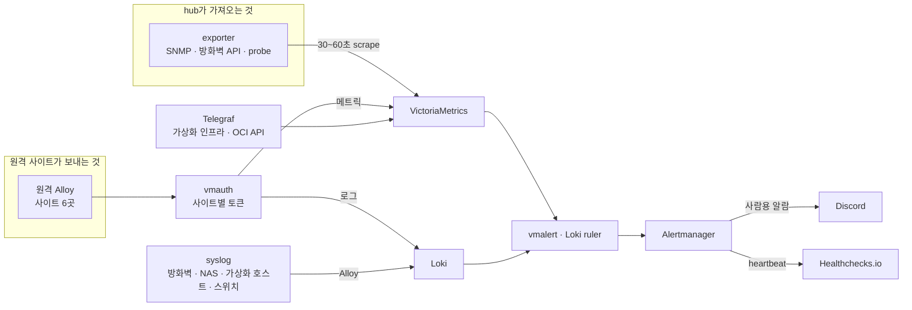

# 관측 스택

[README](../README.md)로 돌아가기

홈랩과 클라우드의 모든 호스트가 보내는 메트릭과 로그를 한곳에 모아 보고, 이상이 생기면 알리는 스택입니다. OCI 춘천 리전의 ARM 인스턴스 한 대(4 OCPU, 24GB)에서 docker compose로 돌립니다. 이 호스트를 쿠버네티스로 옮기지 않은 이유는 [설계 판단](decisions.md)에 있습니다.

## 구성 요소

| 역할 | 구성 요소 | 비고 |
|---|---|---|
| 메트릭 저장 | VictoriaMetrics | 보존 180일 |
| 로그 저장 | Loki | 보존 30일 |
| 시각화 | Grafana | 대시보드 23개, 공개 주소 `observability.basphere.dev`(SSO 로그인) |
| 메트릭 알람 평가 | vmalert | 30초마다 평가 |
| 로그 알람 평가 | Loki ruler | |
| 알람 라우팅 | Alertmanager | 그룹화, 억제, 일시 중지, 수신처 분기 |
| 수집 | Grafana Alloy | 호스트 메트릭, 컨테이너 메트릭, 로그 수집을 호스트당 하나로 |
| 장비 수집 | snmp_exporter, opnsense-exporter, blackbox_exporter | 스위치·NAS·AP는 SNMP v3, 방화벽은 REST API, 외부 주소는 HTTP probe |
| API 수집 | Telegraf | 가상화 인프라 API와 OCI Monitoring API를 주기적으로 호출해 넣는다 |
| 원격 수신 관문 | vmauth | 원격 사이트의 push를 받는 단일 입구 |
| 공개 입구 | Caddy | HTTPS, Let's Encrypt 인증서를 Cloudflare DNS 검증으로 자동 갱신 |

2026-09-06에 호스트마다 따로 띄우던 node_exporter, cAdvisor, postgres_exporter, vmagent를 Alloy 하나의 내장 exporter로 합쳤습니다. 호스트에 붙는 수집 컨테이너가 하나로 줄어 설정과 버전 관리가 단순해졌습니다.

## 데이터 흐름

기본은 hub가 대상에 HTTP 요청을 보내 가져오는 pull 방식입니다. 대상이 살아 있는지가 `up` 메트릭으로 자동으로 남습니다. 예외는 세 가지입니다. API를 불러야 하는 대상(가상화 인프라, OCI)은 Telegraf가 대신 호출해서 넣고, hub 밖의 호스트는 각자의 Alloy가 hub로 보내고(push), 장비 로그는 syslog로 받습니다. 스위치만 오래된 BSD 형식 syslog를 보내서, 작은 rsyslog 컨테이너가 표준 형식으로 바꿔 Alloy에 넘깁니다.

## 원격 사이트와 수신 관문

hub 밖에서 데이터를 보내는 곳은 6곳입니다. 로컬 LLM 서버, 쿠버네티스 클러스터, OCI 오사카의 Keycloak VM과 Omni VM, OCI 싱가포르의 ratatosk.io, 그리고 디스크 SMART 값을 보내는 NAS입니다.

원격 쪽이 보내는 push를 고른 이유는 방화벽 때문입니다. hub가 원격을 가져오려면 원격마다 들어오는 방향을 열어야 하지만, push는 원격에서 나가는 방향 한 줄이면 됩니다.

VictoriaMetrics와 Loki는 자체 인증이 없어서 직접 열지 않습니다. 대신 vmauth 하나만 VPN 쪽 사설 인터페이스에 열고, 다음 규칙으로 받습니다.

- 사이트마다 토큰을 따로 발급합니다. 하나가 새면 그 사이트만 회수하면 됩니다.
- 요청 경로로 백엔드를 가릅니다. 메트릭 쓰기는 VictoriaMetrics로, 로그 push는 Loki로 갑니다.
- 토큰마다 허용 경로를 목록으로 둡니다. 목록에 없는 경로는 vmauth가 백엔드에 닿기 전에 거절합니다. NAS 토큰은 메트릭 가져오기 경로 하나만 열어 유출 시 피해 범위를 줄였습니다.
- AI 에이전트가 쓰는 읽기 전용 사용자는 조회 경로만 열려 있습니다. 쓰기 경로를 부르면 거절됩니다.

## 라벨 규약

모든 메트릭과 로그는 `host` 라벨로 어느 호스트의 것인지 구분합니다. 같은 이름을 메트릭과 로그 양쪽에 쓰기 때문에, 한 호스트의 메트릭에서 로그로 바로 넘어갈 수 있습니다.

로그에는 `layer`(물리 장비, 컨테이너, 쿠버네티스 등), `source`(syslog, container, system 등), `app`, `container_name`, `severity`를 붙입니다. 쿠버네티스 로그의 `severity`는 정규식 단계로 정합니다. klog의 한 글자 접두사를 가장 먼저 믿고, 그다음 JSON이나 logfmt의 level 필드, 마지막으로 일반 키워드를 봅니다. 형식이 섞인 로그에 JSON 파서를 걸면 맞지 않는 줄마다 파싱 오류가 생겨서 정규식만 씁니다.

운영하며 배운 규칙이 하나 있습니다. 라벨 값을 바꾸면 보존 기간(로그 30일) 동안 옛 값과 새 값이 나란히 남습니다. 그 사이에 새 값으로만 거는 알람은 옛 구간을 조용히 놓치므로, 전환 뒤 한동안은 양쪽 값을 함께 고르거나 그 라벨을 조건에서 뺍니다.

## 알람 판정 원칙

알람 룰은 178개입니다(메트릭과 로그 합계, 2026-10-13). 룰을 쓸 때 다음 원칙으로 판정 방식을 고릅니다.

- 정상값이 0인 지표(디스크 재할당 섹터, 경고 비트)는 상태 값이 0을 넘으면 울립니다. 구조적으로 오탐이 없습니다.
- 정상적으로 조금씩 늘어나는 지표(SSD 불량 블록 누적 수)는 넓은 시간 창과 배수 임계로 가속만 잡습니다. `increase(...[24h]) > 0` 같은 룰은 한 번 늘면 24시간 내내 발화 상태로 남아 쓸모가 없습니다.
- 대상이 죽으면 함께 사라지는 지표(쿠버네티스 볼륨 사용량 등)는 정작 문제가 생긴 순간 조용해집니다. 인벤토리 지표와의 차집합으로 "선언은 됐는데 값이 없는" 상태를 따로 잡습니다.
- 서버가 내놓는 설정 값을 단언하는 룰(예: LLM 서버의 컨텍스트 길이)은 값을 바꾸는 동안 이전 값과 새 값을 둘 다 허용합니다. 바꾸는 쪽이 알람 쪽을 기다리지 않아도 되고 오발화가 없습니다.
- 로그 룰은 대상이 정상이면 검증 결과가 비는 것이 맞습니다. 통과를 보이려면 과거 사고 시각을 지정한 조회로 발화 시점, 회복 뒤, 현재의 세 점을 확인합니다.

전달은 Discord로 하고, 심각도에 따라 재알림 주기를 다르게 둡니다. 같은 대상의 critical이 울리는 동안에는 warning을 억제합니다.

## 알람 경로 자체의 감시

알람을 보내는 쪽이 죽으면 아무 알람도 오지 않습니다. 이를 잡으려고 항상 발화하는 Watchdog 알람을 외부 서비스 Healthchecks.io로 보냅니다. 실제 신호 간격은 약 2분이고, 저쪽은 5분 주기에 10분 유예로 설정해 최악의 경우 약 15분 안에 "hub가 조용하다"는 알림이 옵니다. 신호 도착까지는 확인했고, 일부러 끊어서 알림이 오는지 보는 시험은 아직 하지 않았습니다.

## 배포 전 검증

대시보드와 알람은 배포한 뒤 화면에서 비어 있는 패널을 발견하는 일이 반복되기 쉽습니다. 그래서 확인을 배포 전으로 옮겼습니다.

| 도구 | 하는 일 |
|---|---|
| 대시보드 쿼리 검증 | 대시보드의 모든 패널 쿼리를 실제 저장소에 보내 결과가 비는 패널을 찾습니다. 템플릿 변수는 정규식으로 바꿔 데이터 존재만 확인합니다 |
| 알람 룰 검증 | 룰 전체를 평가하고, 비교 연산자 오른쪽을 뗀 왼쪽만 따로 평가합니다. 왼쪽이 비면 그 룰은 절대 울릴 수 없는 죽은 룰입니다 |
| 패널 중복 검사 | 여러 대시보드에 같은 쿼리가 흩어져 있는지 찾습니다 |
| 드롭다운 동적 검증 | Playwright로 Grafana를 실제 렌더해 변수 드롭다운의 모든 선택지마다 비는 패널이 생기는지 봅니다. 변수가 패널을 거르지 못하는 결함은 정적 검사로는 안 잡힙니다 |
| PR 정적 검사 | 시크릿 스캔, YAML·JSON 파싱, 알람 룰 문법, Alloy 설정 검증, compose 설정 렌더 |

대시보드나 알람 파일을 편집하면 해당 검증이 자동으로 돕니다.

## 카디널리티 기준선

시계열이 너무 많아지면 저장과 조회가 함께 느려집니다. 2026-08-14에 기준선을 쟀습니다.

| 항목 | 값 |
|---|---|
| 활성 시계열 | 140,292 (2026-10-13 약 137,000) |
| 시계열 교체율 | 초당 0.09 |
| 디스크 | 91일에 5.1GB |
| 수집률 | 초당 약 2,900 샘플 |

결론은 지금 규모가 문제가 아니라는 것이었습니다. 이 인스턴스는 10~20배를 감당합니다. 시계열의 88%는 어떤 대시보드나 알람도 쓰지 않지만, 장애 때 찾게 되는 지표라서 줄이지 않습니다. 진짜 위험은 절대량이 아니라 교체율입니다. 파드 이름이 바뀌는 롤아웃마다 새 시계열이 생기고 보존 기간 동안 색인에 남습니다. 그래서 줄이는 대신 성장을 감지하는 알람(시계열 수, 교체율) 두 개를 걸어 두었습니다.
