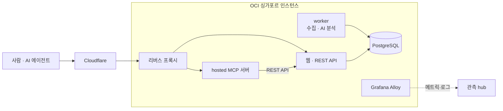

# ratatosk.io

CNCF 프로젝트의 릴리스 노트를 읽어 사람과 AI 에이전트가 바로 쓸 수 있는 형태로 정리하는 서비스입니다. 기획, 개발, 운영을 혼자 합니다. 이 문서는 공개된 범위에서 서비스의 구성과 운영 중 배운 것을 정리합니다. 전체 구성은 [README](../README.md)에 있습니다.

## 무엇을 하는 서비스인가

ratatosk.io는 CNCF 프로젝트 76개(2026-10 기준)의 릴리스 노트를 매시간 읽고, 릴리스 하나를 여러 개의 "변경"으로 나눕니다. 변경 하나는 보안 수정, 호환성을 깨는 변경, 삭제, 폐기 예정, 기본값 변경 같은 한 가지 사실이고, 그것이 건드리는 식별자(CVE 번호, 플래그, CRD, 설정 필드)와 릴리스 노트 원문 인용을 함께 가집니다.

변경마다 세 가지 축이 붙습니다.

| 축 | 뜻 |
|---|---|
| family | 무슨 종류인가: security, breaking, deprecated |
| bucket | 지금 무엇을 해야 하나: 모두에게 해당(action), 설정에 따라 해당(check), 나중에 예정(plan), 기록용(other) |
| applies_if | 해당 여부를 판정하는 조건식. 사람이 읽는 문장이 아니라 에이전트가 자기 설정과 대조해 평가하는 식 |

같은 보안 수정이 여러 브랜치에 나뉘어 들어가는 경우를 위해, 릴리스를 넘어서 같은 문제를 하나로 묶는 단위(matter)도 둡니다. 최신 브랜치 하나만 보고 "이미 고쳐졌다"고 착각하는 일을 막기 위해서입니다. 분석은 AI가 생성하므로, 서비스는 행동하기 전에 원문을 확인하라고 안내합니다.

## 구성

- OCI 싱가포르 리전의 ARM 인스턴스 한 대에서 docker compose로 돕니다. 웹과 REST API, worker, PostgreSQL, 방문 분석(Umami), hosted MCP 서버, 리버스 프록시, 관측 수집기(Alloy)가 각각 컨테이너입니다.
- 앞단은 Cloudflare입니다. 데이터는 부트 디스크와 분리한 별도 볼륨에 두고, 볼륨 백업은 주 1회 돕니다.
- 사람은 웹으로, 에이전트는 MCP나 REST API로 씁니다. 계정이나 API 키는 필요 없습니다.

인스턴스와 네트워크 정의는 OCI 전체 구성과 함께 IaC로 관리합니다([hybrid-cloud.md](hybrid-cloud.md)).

## MCP 서버

에이전트용 MCP 서버는 [ratatosk-mcp](https://github.com/garlicKim21/ratatosk-mcp)로 공개했습니다(Apache-2.0, v0.9.1, awesome-mcp-servers와 MCP Registry 등재). 두 가지로 씁니다. ratatosk.io의 hosted 엔드포인트에 바로 붙이거나, Docker나 Helm으로 자기 환경에서 띄웁니다.

| 툴 | 하는 일 |
|---|---|
| `check_stack` | 운영 중인 컴포넌트 버전을 받아 업그레이드 경로의 변경을 action과 check로 나눠 돌려줍니다 |
| `list_changes` | 증분 변경 피드 |
| `changes_by_entity` | CVE, CRD, 플래그 같은 식별자 하나로 역조회 |
| `get_matter` | 같은 문제가 들어간 모든 릴리스 |
| `get_release`, `list_releases` | 릴리스 하나의 전체, 프로젝트별 최근 릴리스 요약 |
| `list_projects` | 추적 중인 프로젝트 목록과 정식 이름 |

자기 환경에서 띄우면 `check_stack`은 프로젝트 이름만 서버로 보내고 버전 비교는 그 프로세스 안에서 합니다. 어떤 버전을 운영하는지가 바깥으로 나가지 않게 하려는 설계입니다.

### 설계에서 배운 것

받는 입력 형태는 좁게 두고, 틀렸을 때 정답 예시를 보여 주는 쪽이 효과가 컸습니다. 로컬 모델(Qwen)이 `check_stack`의 부품 목록을 배열이 아니라 JSON 문자열로, 키 이름도 틀리게 보내 8번 호출이 모두 스키마 검증에서 거부된 적이 있습니다(0.8.0). 같은 지시문으로 클라우드 모델(Gemini)은 정상이었으니 지시문이 아니라 모델의 인자 작성 문제였습니다. 0.9.0에서 거부 메시지에 올바른 호출 예시를 넣자, 같은 모델이 한 번 거부된 뒤 첫 재시도에서 통과했습니다. 잘못 온 형태를 하나 더 받아 주는 방법도 검토했지만 하지 않았습니다. 받는 형태가 늘수록 무엇이 올바른 형태인지 흐려지고, 예시 한 줄로 이미 해결됐기 때문입니다.

비슷한 결론이 에이전트 평가에서도 나왔습니다(아래). 프롬프트에 규칙을 더 쓰면 한쪽 지표가 오르는 대신 다른 쪽이 떨어지는 일이 반복됐고, 같은 정보를 서버 응답 데이터에 넣었을 때 비로소 양쪽이 함께 올랐습니다. 프롬프트는 그 배포 하나에만 효과가 있고, 툴의 스키마와 응답과 에러 메시지를 고치면 그 툴을 부르는 모든 클라이언트에 효과가 갑니다.

## AI 에이전트 평가

홈랩 쿠버네티스의 kagent 위에서 ratatosk-agent를 운영합니다. 클러스터에서 돌고 있는 컴포넌트 버전을 직접 확인하고 ratatosk 데이터와 대조해, 해당되는 보안 수정과 호환성 변경을 보고하는 에이전트입니다.

2026-07에 이 에이전트의 응답 품질을 통제 실험으로 측정했습니다.

- 정답은 에이전트를 거치지 않고 kubectl과 talosctl로 직접 확인한 클러스터 상태로 정했습니다.
- 100점짜리 채점표를 데이터를 모으기 전에 고정했습니다. 항목은 커버리지, 판정 정확성, 조건 근거, 정직성, 근거 무결성입니다.
- 조건마다 20번씩, 매번 새 대화로 돌렸고 전체 약 120번을 실행했습니다.
- 측정, 판정 전달, MCP 서버와 프롬프트 개선, 재측정을 다섯 번 왕복했습니다. 그동안 MCP 서버는 v0.4.1에서 v0.6.0이 됐습니다.

| 지표 | 처음 | 마지막 |
|---|---|---|
| 총점 | 52.7 | 82.8 |
| 중요(critical) 이슈를 빠뜨린 비율 | 30% | 0% |
| 해당 없는 이슈를 해당으로 적은 비율 | 35% | 0% |
| 점수 표준편차 | ±9.3 | ±7.5 |

없는 버전을 지어내는 응답은 마지막 세 번의 측정에서 0건이었습니다.

2026-09에는 같은 에이전트를 클라우드 모델(Gemini)과 로컬 모델(Qwen)로 나눠 돌렸습니다. 로컬 모델에서 드러난 문제가 위의 인자 형식 문제와, Go 런타임의 프롬프트 캐시 문제입니다. 캐시 문제의 원인과 upstream 수정은 [local-llm.md](local-llm.md)에 있습니다. 런타임 전환과 MCP 서버 0.9.0을 함께 적용한 뒤 같은 질문 6개의 처리 시간이 2,348초에서 642초로 줄었습니다.

## 운영 사건

### 스크레이핑 봇넷 (2026-08)

14시간 동안 요청 197만 건이 들어왔습니다. 평소의 50배였고, 주거용 프록시를 거친 IP 26,859개에서 왔습니다. 방문 분석 대시보드의 비정상적인 급증으로 발견했고, Cloudflare Managed Challenge를 적용하고 6분 만에 97%를 막았습니다. 데이터 손실과 실사용자 오류는 없었습니다. 진단은 웹 서비스 담당과 관측 담당 AI 에이전트가 문서를 주고받으며 나눠 맡았습니다. 경과는 [보고서](https://tech-recipe.tistory.com/54)에 있습니다.

### 외부 probe 간헐 실패 (2026-08 ~ 09)

관측 hub의 외부 probe가 ratatosk.io를 간헐적으로 실패로 판정했습니다. 오리진 설정, 허용 목록, HTTP 버전 같은 서비스 쪽 원인을 하나씩 배제한 뒤, probe를 구간별로 나눠 대조했습니다. Cloudflare를 거치는 ratatosk.io probe, 오리진에 직접 가는 probe, 같은 Cloudflare를 거치는 다른 서비스 probe를 같은 시각에 비교한 것입니다. 본 probe가 실패한 688분 동안 오리진 직접 probe는 모두 성공했고, 다른 서비스 probe도 682분 성공했습니다. 원인은 Cloudflare 엣지와 싱가포르 오리진 사이 공인 구간의 패킷 유실로 판정했고, 서비스 설정으로 고칠 구간이 아니라고 결론냈습니다. 지금은 알람이 울릴 때 구간별 probe 값이 알람 설명에 함께 찍혀, 다시 일어나면 어느 구간인지 바로 읽힙니다.

## 관측 연동

인스턴스 위의 Alloy 하나가 호스트, 컨테이너, PostgreSQL 지표와 컨테이너 로그를 관측 hub로 보냅니다. hub에는 수집 파이프라인, 사용자, 시스템 세 갈래의 대시보드와 서비스 가용성 알람이 있습니다. 수집 설정은 이쪽이, 대시보드와 알람은 hub가 맡고, 라벨이나 job 이름을 바꿀 때는 미리 알려 hub의 알람이 조용히 깨지지 않게 합니다. 관측 구조 전체는 [observability.md](observability.md)에 있습니다.
